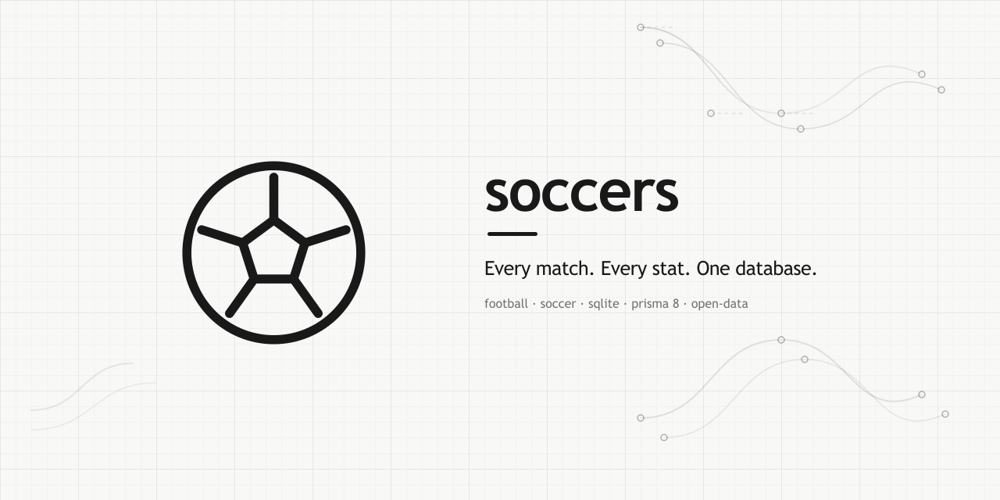

# soccers

[](https://github.com/hieudoanm/soccers/actions/workflows/ci.yaml?branch=master) [](LICENSE)

Topics: `football`, `soccer`, `sqlite`, `prisma`, `open-data`, `data-analysis`, `mars`

**soccers** — a historical football/soccer data platform and a blog of
data-analysis notebooks: **~300k matches**, 11k+ players with event-level
stats, standings, and competition data across 60+ leagues and tournaments —
all stored in SQLite via Prisma 8, and analysed with
[Mars](https://github.com/hieudoanm/mars) notebooks.

[Live site](https://hieudoanm.github.io/soccers) · [Technical docs](./AGENTS.md)



## Features

| Feature                | Route                           | What it does                                                                               |
| ---------------------- | ------------------------------- | ------------------------------------------------------------------------------------------ |
| **Blog**               | `/blog/`                        | Football data-analysis posts, each backed by a runnable `.mars` notebook                   |
| **Series**             | `/blog/series/`                 | Posts grouped into Match Analysis, Management, and Record Books series                     |
| **Home Advantage**     | `/blog/home-advantage/`         | Home vs away win rates across 301k matches — the modern parity trend                       |
| **Win Streaks**        | `/blog/win-streaks/`            | How rare is five-in-a-row? 4,110 streaks ≥5 — Celtic's 25 is the record                    |
| **Two-Goal Lead**      | `/blog/two-goal-lead/`          | Is 2–0 the most dangerous lead? Goal-by-goal replay of 3,703 matches                       |
| **Comebacks**          | `/blog/comebacks/`              | Who erases deficits? 57% trail, 10.5% recover, zero 3+-goal comebacks                      |
| **Underdogs**          | `/blog/underdogs/`              | Elo sweep over 301k matches — who beats stronger opponents?                                |
| **Dying Minutes**      | `/blog/late-goals/`             | 23% of all goals arrive after minute 76                                                    |
| **Away Days**          | `/blog/away-day/`               | Home/away win-rate splits — Meppen's +38pt gap is the extreme                              |
| **Opening Goal**       | `/blog/opening-goal/`           | Scoring first wins 71.2% — best protectors and recoverers                                  |
| **Draw Specialists**   | `/blog/draw-specialists/`       | Marseille draws 45% of the time — who are the draw merchants?                              |
| **Fixture Congestion** | `/blog/fixture-congestion/`     | Does short rest hurt? The effect is real but marginal                                      |
| **New Manager Bounce** | `/blog/manager-change/`         | 43 EPL managerial changes — the bounce is real but oversold                                |
| **Best Debut Season**  | `/blog/manager-debut/`          | 80 first seasons ranked vs club expectations — pre-season hires win                        |
| **Record Books**       | `/blog/best-of-premier-league/` | 16 "Best of" competitions — league titles, tournament records, unbeaten sides, top scorers |

## Monorepo layout

```text
.
├── .github/workflows/ci.yaml   # typecheck → lint → test → build
├── assets/                     # branding SVG/PNG sources + sync scripts
├── packages/
│   ├── data/                   # @soccers/data — Prisma 8 data platform
│   │   ├── src/prisma/         # contract.prisma + emitted contract.{json,d.ts}
│   │   ├── scripts/            # import-football-data, import-statsbomb,
│   │   │                       # export-csv, contract-to-dbml, file-sizes
│   │   ├── schema/             # generated schema.dbml/.svg/.png diagrams
│   │   ├── csv/                # generated CSV exports (gitignored)
│   │   └── dev.db              # SQLite database (gitignored, reproducible)
│   └── landing/                # @soccers/landing — Next.js blog + marketing site
│       ├── md/posts/           # blog post sources (Markdown + front matter)
│       ├── mars/posts/         # .mars notebooks that produce the analyses
│       │   └── football-analysis/  # data/*.csv exports (gitignored)
│       ├── src/app/            # App Router: /, /blog, /blog/[slug]
│       ├── src/components/     # shared molecules + blog components
│       └── out/                # static export for GitHub Pages
├── AGENTS.md                   # technical reference for contributors/agents
└── turbo.json                  # task graph and cache outputs
```

## Data platform

`packages/data` is a **Prisma 8** project: `contract.prisma` is the source of
truth, `prisma contract emit` produces typed `db.orm` / `db.sql` accessors,
and `dev.db` is a plain SQLite file (~178 MB, fully reproducible).

- **ORM lane:** `db.orm.Match`, `db.sql.match` — model names in the ORM,
  snake_case storage names (`@@map`/`@map`) in SQL.
- **Schema diagram:** `pnpm dbml` regenerates `schema/schema.{dbml,svg,png}`.
- **Browse the data:** `pnpm db` opens `sqlite3 dev.db`;
  `pnpm db:web` serves it read-only in Datasette at `localhost:8001`.
- **CSV export:** `pnpm export:csv` dumps every table to `csv/`.

### Data sources

- **football-data.co.uk** — results, stats, and standings for 20+ European
  leagues (1993–present) plus 16 single-file countries (ARG, AUT, BRA, CHN,
  DNK, FIN, IRL, JPN, MEX, NOR, POL, ROU, RUS, SWE, SWZ, USA).
- **StatsBomb open data** — event-level JSON (passes, shots, cards,
  substitutions, lineups) for World Cups, Euros, Champions League, and
  domestic leagues back to 1958; streamed once from the repo tarball.

| Table                                                   | Rows (approx.) | Contents                                            |
| ------------------------------------------------------- | -------------- | --------------------------------------------------- |
| `match`                                                 | 301,353        | Fixtures, scores, dates, status                     |
| `match_team_stat`                                       | 257,030        | Shots, shots on target, corners, fouls, cards, xG   |
| `player_match_stat`                                     | 152,133        | Per-player goals, assists, xG, passes, duels, cards |
| `match_lineup`                                          | 152,133        | Starting XI + subs per match                        |
| `goal`                                                  | 11,328         | Goals with minute, type, assist                     |
| `match_event`                                           | 29,297         | Cards, substitutions, injuries                      |
| `standing`                                              | 16,064         | Computed league tables                              |
| `player` / `team`                                       | 11,794 / 808   | Squad lists and club metadata                       |
| `manager`/`venue`/`referee`/`country`/`league`/`season` | —              | Reference data                                      |
| `transfer`, `injury`                                    | 0              | No free historical source yet                       |

## Analysis notebooks

Every blog post is generated from a **Mars notebook** (`.mars`, Rust
runtime) living next to its exported Markdown:

```text
mars/posts/record-books/best-of-premier-league.mars   # the analysis
mars/posts/record-books/best-of-premier-league.md     # exported output
md/posts/record-books/best-of-premier-league.md       # blog source
```

Posts are organised into **series** by directory — `match-analysis`,
`management`, and `record-books` — surfaced at `/blog/series` (series
metadata lives in `src/lib/series-meta.ts`).

Workflow: edit cells → `mars notebook run <file>.mars` (~1 min; deps are
pinned in notebook `cargo_lock`) → `mars notebook export <file>.mars md
<file>.md` → copy into `md/posts/` with front matter. Notebooks use
**polars** (CSV → lazy group-bys), **ndarray** (trend statistics), and
**plotters** (SVG charts rendered inline as `data:` URIs). Goal-timing
analyses run on the StatsBomb subset (~3,700 matches with event data);
result-only analyses cover all 301k matches.

To regenerate the analysis inputs from `dev.db`:

```bash
cd packages/data
sqlite3 -header -csv dev.db "SELECT ..." > ../landing/mars/posts/data/matches_full.csv
```

(see each notebook's intro cell for the exact query)

## Get Started

Requirements: Node **26.13.1** (see `.nvmrc`) and pnpm **12**.

```bash
pnpm install
pnpm dev          # http://localhost:3000
```

Root scripts fan out through Turborepo:

| Command          | Description                                               |
| ---------------- | --------------------------------------------------------- |
| `pnpm dev`       | Development server                                        |
| `pnpm build`     | Production build; static export in `packages/landing/out` |
| `pnpm lint`      | ESLint across the workspace                               |
| `pnpm typecheck` | `tsc --noEmit` across the workspace                       |
| `pnpm test`      | Vitest unit tests (80% coverage thresholds)               |
| `pnpm format`    | Prettier + `prisma contract format`                       |

```bash
pnpm --filter @soccers/data db         # sqlite3 shell on dev.db
pnpm --filter @soccers/data db:web     # Datasette browser UI on :8001
pnpm --filter @soccers/data import:football-data   # football-data.co.uk importer
pnpm --filter @soccers/data import:statsbomb       # StatsBomb open-data importer (~7 min)
pnpm --filter @soccers/data sizes                  # CSV/DB file sizes
```

## Adding a blog post

Drop a `.md` file into `packages/landing/md/posts/` — the top-level
directory becomes the post's **series** (see `/blog/series`); files at
the root are uncategorised. Front matter:

```markdown
---
title: 'Post title'
description: 'One-line summary'
author: 'hieudoan'
date: '2026-11-25T09:30'
order: 13
tags: ['football', 'analysis']
---

Post body in Markdown (GFM tables supported, fenced code is highlighted).
```

For a data-driven post, create the `.mars` notebook under
`mars/posts/<series>/`, run it, export to `.md`, then copy it into
`md/posts/` and prepend the front matter.

## Deployment

`.github/workflows/ci.yaml` runs on every push and pull request to
`master`: checkout → pnpm install → `pnpm typecheck` → `pnpm lint` →
`pnpm test` → `pnpm build`.

The landing builds with `BASE_PATH=/soccers` and `output: 'export'`,
producing `packages/landing/out`, which is deployed to GitHub Pages at
`https://hieudoanm.github.io/soccers`. Set **Settings → Pages → Source**
to **GitHub Actions** once; the workflow cannot configure that itself.

## License

MIT — see [LICENSE](./LICENSE).
